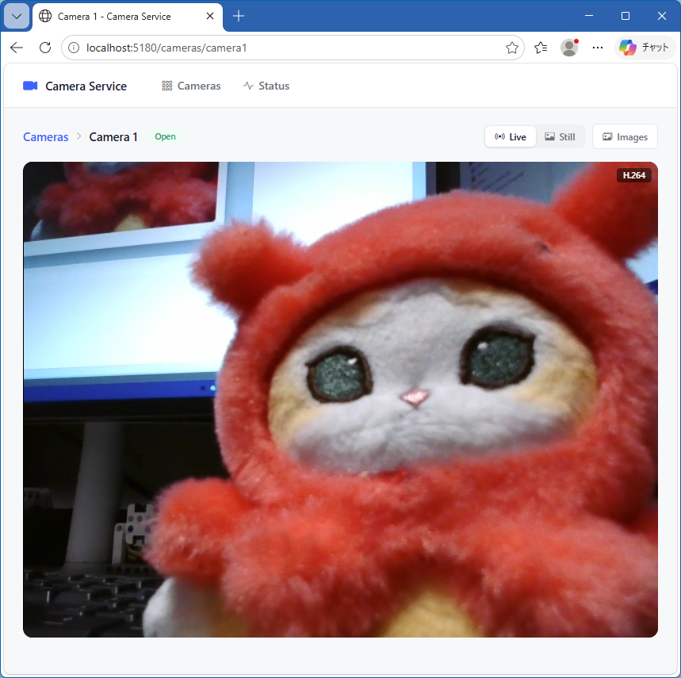

# 📷 camera-service

🌐 [English](README.md) | 日本語

カメラをブラウザーへ配信し、決めた時刻に静止画を保存する Windows サービス。使っていないカメラとエンコーダーは閉じる。



## ✨ 機能

| 機能 | 内容 |
|:--|:--|
| 🎥 ライブ | H.264(ハードウェアエンコーダー、WebCodecs)または MJPEG |
| 🖼️ 静止画 | 現在のフレームの JPEG |
| 💾 定期保存 | カメラごとの Cron、撮影時刻の焼き込み |
| 🗂️ 保存画像の閲覧 | 日付 → 時間 → サムネイル → 拡大、タイムラプス、ダウンロード |
| 🧹 自動削除 | 日数と空き容量で削除 |
| 💤 オンデマンド | 使うときに開き、使わなければ閉じる |
| 🔌 復旧 | 失敗したカメラを開き直し、切れたライブをつなぎ直す |
| 📷 複数カメラ | 設定に列挙 |
| ❤️ ヘルスチェック | `/health` |

## 💻 動作環境

- Windows 11、ASP.NET Core 10 ランタイム(ビルドは .NET 10 SDK)
- MediaFrameReader 対応の USB カメラ(YUY2 または NV12)
- ⚠️ カメラの使用を許可(設定 > プライバシーとセキュリティ > カメラ)

## ▶️ 試す

```
dotnet run --project src/CameraService.Host
```

- `http://localhost:5180`: カメラ一覧
- `/api/devices`: カメラと形式(`Device` / `DeviceId` に使用)
- 💡 `appsettings.json` の例は `camera1` を毎分保存(`Snapshot:Enable` で無効化)

## 📦 サービスとして導入

1. 発行
   ```
   dotnet publish src/CameraService.Host -c Release -o C:\Services\CameraService
   ```
2. 発行先の `appsettings.json` の `Cameras` を編集
3. 登録して起動(管理者の PowerShell)
   ```
   pwsh tools\Install-Service.ps1 -Path C:\Services\CameraService
   ```
4. 削除
   ```
   pwsh tools\Uninstall-Service.ps1
   ```

- LocalSystem で動作、自動起動(`-StartupType Manual` で手動)、失敗の 1 分後に再起動
- `-FirewallPort 5180` で他の PC 向けにポートを開放
- ⚠️ 発行先のフォルダーを使う(ビルドの出力には `wwwroot` がない)
- **ログ:** 発行先の 1 つ上の `Log\CameraService_yyyyMMdd.log`。`Serilog:MinimumLevel:Default` を `Debug` にすると保存ごとに 1 行
- ⚠️ 起動しないときはログを確認(設定の誤りと JSON のエラーを記録)

## ⚙️ 設定

`appsettings.json` またはコマンドライン(`--Cameras:0:Device="ELECOM 2MP Webcam"`)で指定。不正な設定では起動しない。

### 🌐 ポート

| キー | 内容 | 既定値 |
|:--|:--|:--|
| `http_ports` | HTTP のポート | `5180` |

### 📷 カメラの動作

| キー | 内容 | 既定値 |
|:--|:--|:--|
| `Camera:IdleTime` | 最後の利用から閉じるまで(秒) | `10` |
| `Camera:WarmupTime` | 開いた直後に捨てるフレームの時間(ミリ秒) | `1000` |
| `Camera:FrameTimeout` | フレームが来ないときに開き直すまで(秒) | `5` |

### 📡 配信

| キー | 内容 | 既定値 |
|:--|:--|:--|
| `Stream:Fps` | MJPEG と静止画の最大 fps | `10` |
| `Stream:Quality` | JPEG の品質(1〜100) | `80` |
| `Stream:H264:Enable` | H.264 のライブ | `true` |
| `Stream:H264:Bitrate` | kbps。0 は解像度で決定(640x480 まで 4000、1280x720 まで 8000、それ以上 16000) | `0` |
| `Stream:H264:KeyFrameInterval` | キーフレームの間隔(秒) | `2` |
| `Stream:H264:PreferHardware` | ハードウェアエンコーダーを優先 | `true` |

- 640x480 で MJPEG は約 5 Mbps(10 fps)、H.264 は約 4 Mbps(全フレーム)
- ⚠️ H.264 は localhost か HTTPS のみ。他の PC から http なら MJPEG

### 💾 保存先と自動削除

| キー | 内容 | 既定値 |
|:--|:--|:--|
| `Storage:Path` | 画像の基準フォルダー(サービスのフォルダーからの相対) | `Images` |
| `Retention:Schedule` | 削除の時刻(Cron)。起動時にも実行 | `0 3 * * *` |
| `Retention:Days` | 残す日数(今日を含む)。0 は無制限 | `30` |
| `Retention:MinFreeSpace` | 残す空き容量(GB)。0 は確認しない | `10` |

### 🎥 カメラ(`Cameras`)

| キー | 内容 | 既定値 |
|:--|:--|:--|
| `Id` | URL とフォルダー名に使用。英数字、`-`、`_`。大文字小文字を区別せず一意 | 必須 |
| `Name` | 表示名 | `Id` |
| `Device` | デバイス名。`Device` と `DeviceId` がなければ形式が合う最初のデバイス | 空 |
| `DeviceId` | `/api/devices` の `id`(同名のデバイスの区別) | 空 |
| `Format` | `Yuy2` / `Nv12` | `Yuy2` |
| `Width` / `Height` / `Fps` | カメラが持つ形式 | `640` / `480` / `30` |
| `Snapshot:Enable` | 定期保存 | `false` |
| `Snapshot:Schedule` | Cron | `* * * * *` |
| `Snapshot:Path` | カメラのフォルダー(`Storage:Path` からの相対) | `Id` |
| `Snapshot:Quality` | JPEG の品質(1〜100) | `90` |
| `Snapshot:Timestamp:Enable` | 時刻の焼き込み | `true` |
| `Snapshot:Timestamp:Format` | 時刻の書式(結果は数字、空白、`+` `-` `.` `/` `:` のみ) | `yyyy/MM/dd HH:mm:ss` |
| `Snapshot:Timestamp:Position` | `TopLeft` / `TopRight` / `BottomLeft` / `BottomRight` | `BottomRight` |
| `Snapshot:Timestamp:Scale` | 文字の大きさ(1 = 7 ドット)。0 は画像の高さで決定(480: 2、720: 3、1080: 4) | `0` |

- ⚠️ 形式が合う仮想カメラ(スマートフォンなど)が選ばれる場合あり。`Device` を指定
- `Format ... not supported` にはデバイスの形式を表示
- 💡 同じ USB に複数台なら NV12(YUY2 は帯域が大きい)

### 🔒 HTTPS

`Kestrel:Endpoints` を指定。`http_ports` は無効になるので HTTP も記載。

```json
"Kestrel": {
  "Endpoints": {
    "Http": { "Url": "http://*:5180" },
    "Https": {
      "Url": "https://*:5181",
      "Certificate": { "Subject": "camera.local", "Store": "My", "Location": "LocalMachine" }
    }
  }
}
```

- 証明書はコンピューターのストアに置き、見る端末で信頼させる
- 他の PC でも H.264 が使え、HTTP/2 になる(HTTP/1.1 はホストごとに 6 接続まで)

## 🕒 時刻の指定(Cron)

5 項目(分 時 日 月 曜日)、または秒を先頭に足した 6 項目。現地時刻。

- 書き方: `*`、`5`、`1,15`、`9-17`、`*/10`、`0-30/5`。数字のみ。曜日は 0〜7(0 と 7 が日曜)

| 例 | 意味 |
|:--|:--|
| `* * * * *` | 毎分 |
| `*/10 * * * * *` | 10 秒ごと |
| `* 22-23,0-5 * * *` | 夜間に毎分(22:00〜5:59) |
| `*/5 9-17 * * 1-5` | 平日 9:00〜17:59 に 5 分ごと |
| `0 3 * * *` | 毎日 3:00 |

- 取りこぼしは後から実行しない
- 前の保存がカメラを待っている間の回は実行しない
- ⚠️ 夏時間の切り替え直後の 1 回はずれる場合あり

## 💾 保存画像

`{カメラのフォルダー}\yyyyMMdd\HHmmss.jpg`。名前は予定の時刻、焼き込みは撮影時刻。

| `Storage:Path` | `Snapshot:Path` | カメラ `front` のフォルダー |
|:--|:--|:--|
| `Images` | 空 | `{サービス}\Images\front` |
| `D:\CameraImages` | 空 | `D:\CameraImages\front` |
| `Images` | `outdoor\front` | `{サービス}\Images\outdoor\front` |
| `Images` | `E:\Front` | `E:\Front` |

- 2 台で同じフォルダーは不可(解決後のパスで確認)
- 640x480、品質 90 で 1 枚最大約 100 KB。毎分の保存で 1 日約 140 MB
- カメラは予定の約 3 秒前に開き、`IdleTime` で閉じる
- 保存の失敗は次に成功するまで警告 1 回

### 🧹 自動削除

- `Retention:Schedule` と起動時に実行
- 日付フォルダー(8 桁の正しい日付)のみ削除。今日は残す
- `MinFreeSpace`: ドライブ上の全カメラを古い順に削除
- 保存をやめたカメラのフォルダーも対象
- ⚠️ ネットワークパス(UNC)の空き容量は確認しない

## 🖥️ 画面

`http://{PC}:5180/`

| ページ | パス | 内容 |
|:--|:--|:--|
| 📷 カメラ一覧 | `/` | 最新の画像、状態、最後の保存、エラー。10 秒ごとに更新 |
| 🎥 カメラ | `/cameras/{id}` | ライブまたは静止画 |
| 🗂️ 保存画像 | `/cameras/{id}/images/{yyyyMMdd}` | 日付 → 時間 → サムネイル → 拡大 |
| 📊 状態 | `/status` | 状態、fps、ビットレート、クライアント数、エンコーダー、最後の画像、エラー、空き容量。1 秒ごとに更新 |

### 🎥 カメラ

- **ライブ:** 右上に H.264 か MJPEG を表示
- **赤い `Reconnecting`:** 接続断。最後のコマを残して自動で再接続
- **静止画:** 更新ボタン、または 5 / 10 / 30 / 60 秒ごと。カメラが閉じていれば約 2 秒

### 🗂️ 保存画像

- **更新ボタン:** ページを開いた後の画像を読み込む
- **Time-lapse ボタン:** 選んだ時間から再生

| キー / ボタン | 動作 |
|:--|:--|
| ← / → | 前 / 次 |
| Home / End | 最初 / 最後 |
| Space | タイムラプスの再生 / 停止(5 / 10 / 20 / 30 fps) |
| Esc | 閉じる |
| ⬇ | ダウンロード(`{id}_{yyyyMMdd}_{HHmmss}.jpg`) |

## 🔗 エンドポイント

| パス | 内容 |
|:--|:--|
| `/cameras/{id}/stream.mjpg` | MJPEG |
| `/cameras/{id}/h264` | H.264 の WebSocket([プロトコル](docs/technical.ja.md)) |
| `/cameras/{id}/snapshot.jpg` | 静止画 |
| `/api/images/{id}` | 日付(`yyyyMMdd`、新しい順) |
| `/api/images/{id}/{yyyyMMdd}` | 時刻(`HHmmss`、古い順) |
| `/images/{id}/{yyyyMMdd}/{HHmmss}.jpg` | 保存画像 |
| `/images/{id}/{yyyyMMdd}/{HHmmss}/thumbnail.jpg` | サムネイル |
| `/api/devices` | カメラと形式 |
| `/health` | ヘルスチェック |

不明な `id`、不正な日付・時刻、存在しない画像は 404。

### ❤️ ヘルスチェック

| 結果 | HTTP | 条件 |
|:--|:--|:--|
| `Healthy` | 200 | 下記以外 |
| `Degraded` | 200 | 空き容量が `Retention:MinFreeSpace` 未満、または H.264 エンコーダーなし |
| `Unhealthy` | 503 | カメラの失敗(次のフレームまで)、保存の失敗、フォルダーに書けない |

使われていないカメラは最後の状態のまま。

## ⚠️ 注意

- **カメラの同時利用は不可:** サービスと他のアプリで同時に使えない。他のアプリの使用中は保存が失敗
- **暗い部屋:** 露出が延びて約 10 fps まで下がり、保存も少し遅れる場合あり

## 📚 技術資料

[docs/technical.ja.md](docs/technical.ja.md)
